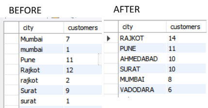
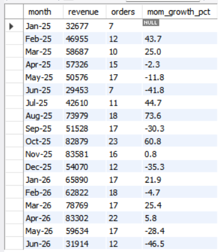
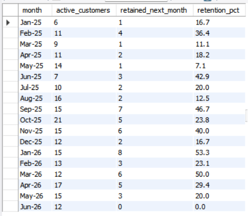
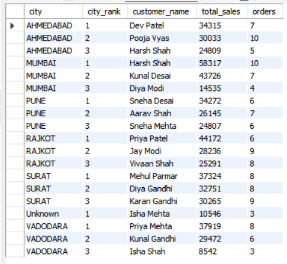
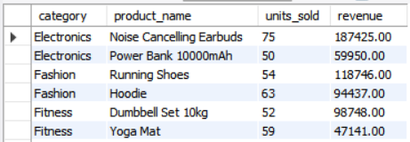
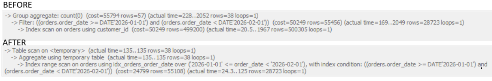

# E-commerce SQL Analytics Project

**Author:** Chirag Kapadiya · **Tools:** MYSQL

End-to-end SQL analysis on a 4-table e-commerce database (60 customers, 305 orders, 778 order lines, Jan 2025 – Jun 2026). It covers data cleaning, revenue trends, customer retention, ranking, and query tuning.

## Data model

```
customers (customer_id PK, customer_name, city, signup_date)
     │ 1
     │
     ▼ N
orders (order_id PK, customer_id FK, order_date, status)
     │ 1
     │
     ▼ N
order_items (order_item_id PK, order_id FK, product_id FK, quantity, unit_price)
     ▲ N
     │
     │ 1
products (product_id PK, product_name, category, unit_price)
```

## Projects and findings

| # | File | Business question | Key finding                                                                                                                                          | Result                          |
|---|------|-------------------|------------------------------------------------------------------------------------------------------------------------------------------------------|---------------------------------|
| 1 | `01_data_cleaning.sql` | Why do city-level totals look wrong? | 12 raw city values (including NULL) collapsed to 7 clean values after `TRIM` + `UPPER`; NULL cities labelled `Unknown`.                              |  |
| 2 | `02_monthly_revenue_growth.sql` | Is revenue growing? | Revenue is volatile month to month (e.g. +74% in Aug 2025, -47% in Jun 2026).                                                                        |  |
| 3 | `03_customer_retention.sql` | What % of buyers return next month? | Retention ranges from about 7% Dec-25 to 53% Jan-26 by month.                                                                                        |  |
| 4 | `04_top_customers_by_city.sql` | Who are the top customers per city? | Top spender in Mumbai (₹58k) is ahead of the next customer by about 33%.                                                                             |  |
| 5 | `05_category_performance.sql` | Which categories earn the most? | Electronics (33%) and Fashion (29%) generate over 60% of revenue; Stationery is only 4%. Stationery also has the highest cancel/return rate (14.7%). |  |
| 6 | `06_query_tuning.sql` | Can an index speed up a date-range query? | With Out Index Query Run In 228 ms After Index 135 ms.                                                                                               |  |

### Query tuning results

| Test (500k rows) | Execution time | Plan |
|---|----------------|---|
| Before index | * 228 ms*      | Seq Scan |
| After `idx_orders_order_date` | *135 ms*       | Index / Bitmap Scan |

## SQL concepts used
CTEs · multi-table JOINs · self-join · window functions (`LAG`, `ROW_NUMBER`, `RANK`, `SUM() OVER`) · `NULLIF` for safe division · views · data cleaning (`TRIM`, `UPDATE`, `COALESCE`) · indexing and execution plans · PostgreSQL and Oracle dialects


## About me
3 years of Oracle SQL / PL/SQL, Oracle Forms & Reports, and Power BI experience, now moving into data analyst and BI developer roles.
